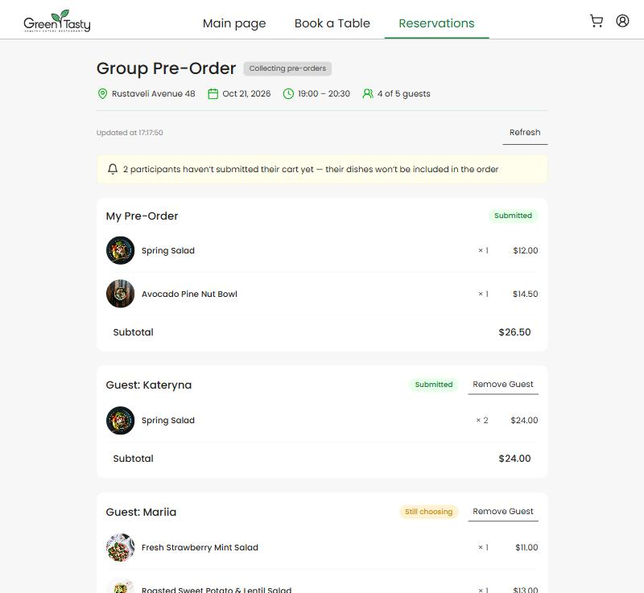
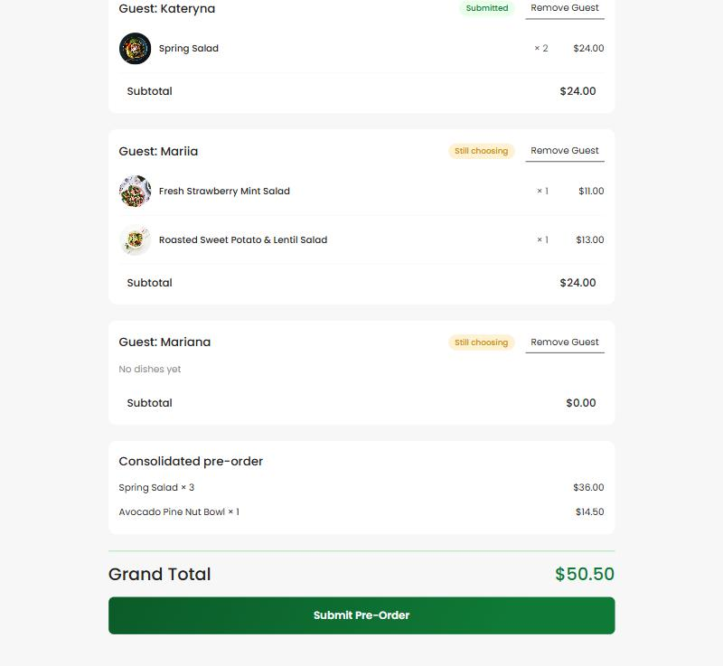
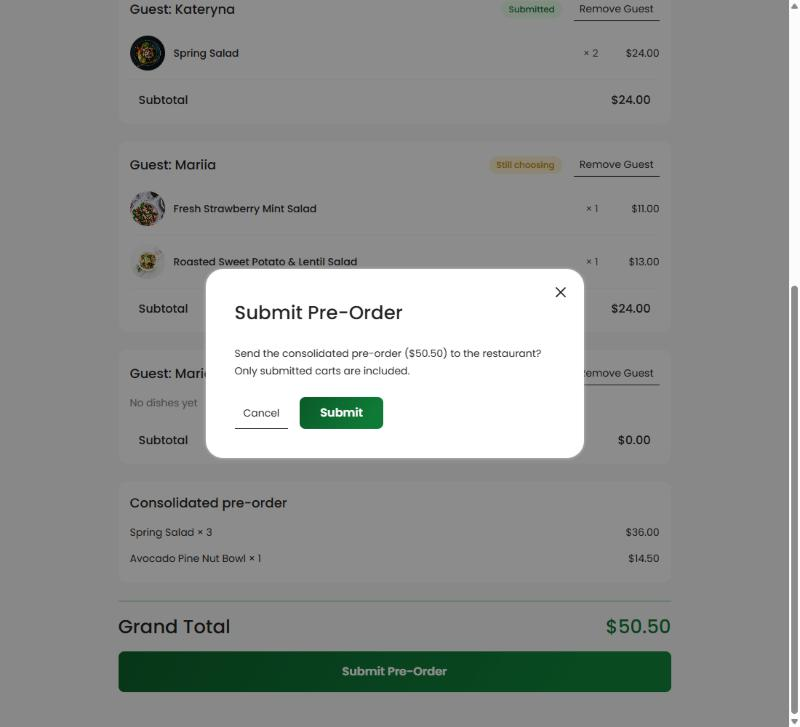
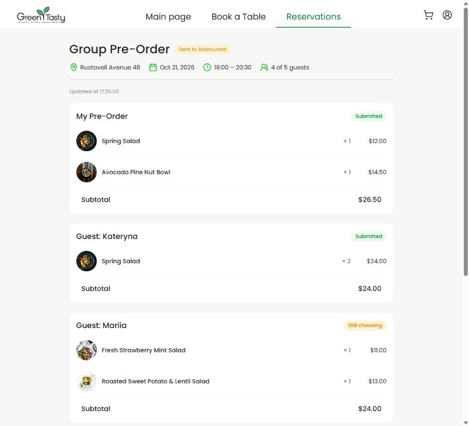
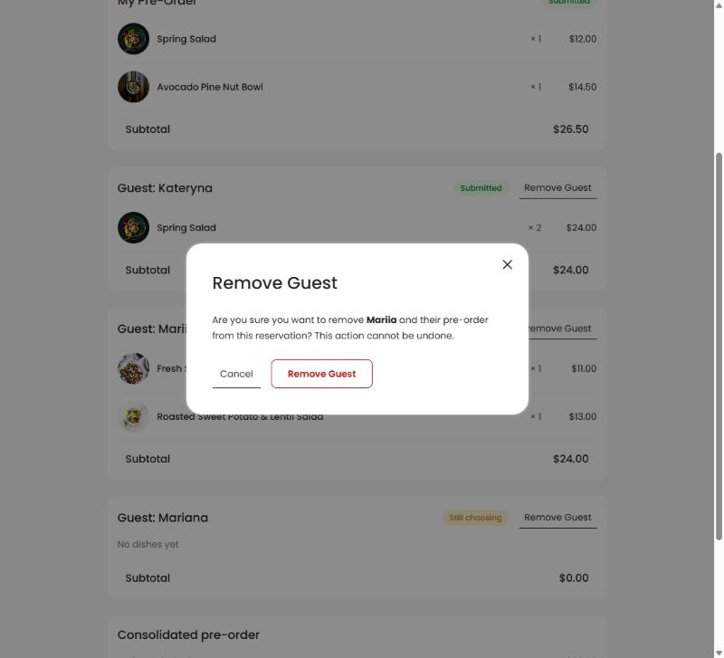
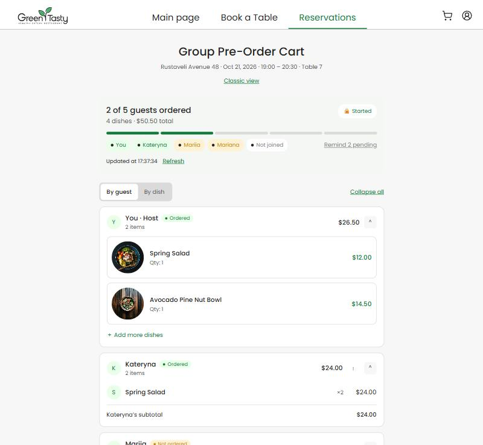
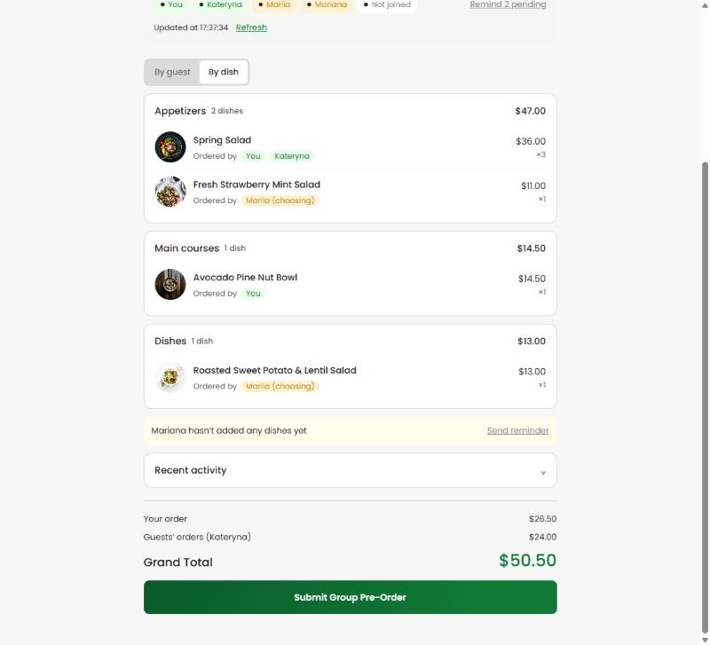

# Домашка #6 — Frontend: екран Owner групового pre-order

Owner бачить, що обрав кожен гість, і відправляє в ресторан одне спільне замовлення.

**Виконано:** практичне, рівень 1, рівень 2, рівень 3 і бонус Remove Guest.
Додатково — друга версія екрана в дизайні з мого власного макета у Figma (див. нижче).

Сторінка: `/reservations/:reservationId/group-order`
(демо без бекенду: `http://localhost:4200/reservations/demo-reservation/group-order?demo`)

---

## Що зроблено по рівнях

### Практичне
- `components/group-orders/participant-card/` — картка учасника: заголовок, страви (фото або перша літера), кількість, ціна, Subtotal, статус кошика **текстом** («Submitted» / «Still choosing»).
- `pages/group-order-page/` — сторінка зі списком учасників, маршрут `reservations/:reservationId/group-order` в `app.routes.ts`.

### Рівень 1 — верстка за макетом
- Шапка: «Group Pre-Order», бейдж статусу, адреса, дата, час, «4 of 5 guests» (пайпи `date`, `currency`).
- Картки, Grand Total, кнопка Submit Pre-Order — за `homework-design/01-owner-review.png`.
- Семантика: `<main>`, один `<h1>`, учасники — `<ul>/<li>`, картка — `<article>`; кольори з `shared/styles/abstracts/colors` через `@use`; адаптив до 375 px.

### Рівень 2 — логіка на мок-бекенді
- `services/group-orders/group-orders.service.ts` — методи під кожен ендпоінт: `getGroupInvite$` (invite-token → invite), `getSessions$`, `getOwnerSessionId$`, `getStatus$`, `submit$`.
- Сторінка бере `reservationId` з URL; стан — `signal()`, похідні значення — `computed()`.
- Власна картка Owner — **My Pre-Order** (`participant.id === guestSessionId`).
- Блок «Consolidated pre-order» через `consolidatePreOrder()`; **Grand Total = сума лише підтверджених кошиків**, а не `total` з API.
- Жовта плашка «N participants haven’t submitted their cart yet…», бейдж «Collecting pre-orders» / «Sent to Restaurant».
- Стани: loading, «Group reservation not found» (404), помилка з «Try again», empty.
- Submit через `<app-modal>`: «Submitting…», захист від подвійного кліку; після успіху — toast, бейдж, екран read-only; при помилці кнопку можна натиснути знову.

### Рівень 3 — справжній API і синхронізація
- Поки група `Open`, кожні 15 с тихо підтягуються кошики і статус (`interval` + `exhaustMap` — новий запит не стартує, поки не відповів попередній).
- Рядок «Updated at …», кнопка **Refresh**; при помилці — «Couldn’t refresh. Showing data from …» без toast (`{ silent: true }` → `SKIP_ERROR_TOAST`).
- Таймер не дублюється після «Try again», зупиняється після Submit і при виході зі сторінки (`takeUntilDestroyed`).
- Перевірено на власному бекенді в AWS (бекенд-трек, ДЗ #5): реєстрація → бронювання на 3 гостей → гість через Invite Link обрав страви й підтвердив кошик → екран Owner.

### Бонус — Remove Guest
- «Remove Guest» біля кожного гостя (не біля Owner і не після Submit), `aria-label="Remove <ім'я>"`.
- Підтвердження через `<app-modal>`; після успіху список і суми оновлюються з відповіді сервера; при помилці список не змінюється.
- `participant-card`: `canRemove = input(false)`, `removeClick = output<Participant>()`; сервіс: `removeSession$()`.

---

## Знайдений і виправлений баг у стартовому коді

`src/app/auth/token.interceptor.ts` не додавав токен логіну до **всіх** адрес з `/guest/`. Але `GET /guest/groups/{id}/sessions` і `DELETE /guest/groups/{id}/sessions/{id}` — ендпоінти **Owner** під Cognito, тож на справжньому бекенді вони отримували `401`, а `forkJoin` скасовував решту запитів сторінки.
Виправлення: без токена йдуть лише справжні гостьові ендпоінти, `/guest/groups/…` отримують токен Owner. Додано 2 тести в `token.interceptor.spec.ts`.

---

## Додатково: екран у дизайні з власного макета Figma

Сторінка `/reservations/:reservationId/group-order/review` (`pages/group-order-review-page/`) — за моїм макетом «Group Pre-Order Cart» з попередньої UX-домашки. Логіка успадкована від основної сторінки, тому тести домашки не зачеплено.
- блок прогресу «N of M guests ordered»: сегменти, чипи учасників, «Starts in …»;
- режими **By guest / By dish** (у By dish — групи за категоріями з меню і «Ordered by»);
- картки, що згортаються, «Collapse all»; меню ⋮ з **Copy invite link** і **Remove guest**;
- картка «You · Host» показує власне замовлення Owner з бекенду (`GET /orders/{reservationId}`), «Add more dishes» веде в меню pre-order;
- функції, яких бекенд поки не підтримує (Edit guest’s order, Send reminder, Recent activity), — неактивні заглушки з підказкою.

---

## Тести

Скопійовано тести всіх рівнів з `homework-tests/` + додано власні (7 для другої версії екрана, 2 для interceptor).

| Набір | Тестів |
|---|---|
| практичне (картка) | 8 |
| рівень 1 → замінено рівнем 2 (сторінка) | 13 |
| рівень 2 (сервіс) | 5 |
| рівень 3 (тихі запити + синхронізація) | 3 + 6 |
| бонус Remove Guest | 1 + 5 |
| екран за власним макетом | 7 |
| `shared/helpers`, що вже були в архіві | 26 |
| **разом `npm run test:hw`** | **74 SUCCESS** |

Перевірки перед здачею — усі пройдені:
```bash
npx tsc -p tsconfig.app.json  --noEmit
npx tsc -p tsconfig.spec.json --noEmit
BACKEND_URL=https://example.com npm run build   # Bundle check passed
npm run test:hw                                 # TOTAL: 74 SUCCESS
```

---

## Скріни

| | |
|---|---|
| Owner Review (рівні 1–2) |  |
| Консолідоване замовлення і Grand Total |  |
| Діалог Submit |  |
| Після відправки — Sent to Restaurant |  |
| Remove Guest (бонус) |  |
| Екран за власним макетом — By guest |  |
| Екран за власним макетом — By dish |  |

Скріни зроблені в демо-режимі (`?demo`, мок-бекенд). Робота з реальним бекендом (рівень 3) перевірена на власному бронюванні.

---

## Як перевіряла результат і використання AI

- Код писався разом з AI-асистентом (Claude): він генерував компоненти, сервіс і стилі за вимогами з `homework-frontend.md` і тестами з `homework-tests/`.
- Я перевіряла: `npm run test:hw` (74 зелені), чотири перевірки зі списку вище, вигляд сторінки за макетом на широкому екрані й на телефоні (375 px), увесь сценарій Submit / Remove Guest на моках.
- Рівень 3 — наживо на своєму бекенді в AWS: бронювання, гість через Invite Link, синхронізація без перезавантаження, Submit на справжньому API. Під час цього знайшли баг з токеном в interceptor (описано вище).
